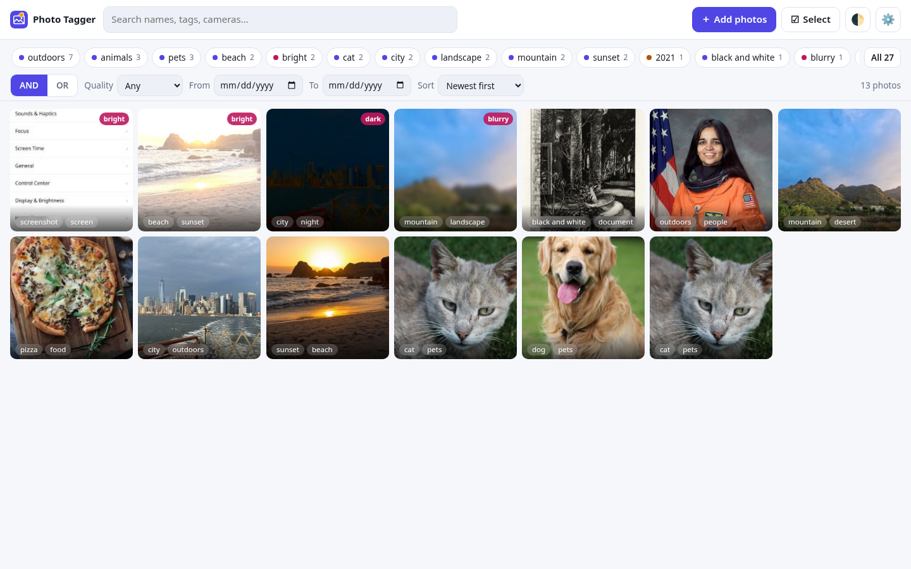
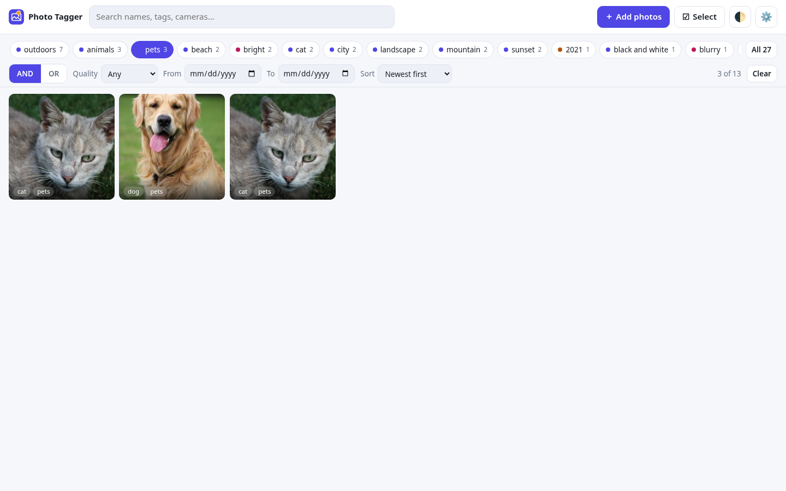
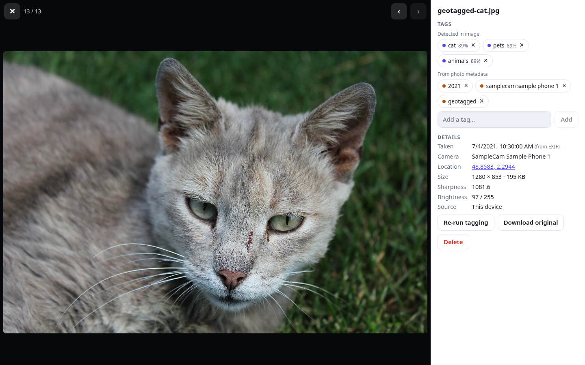
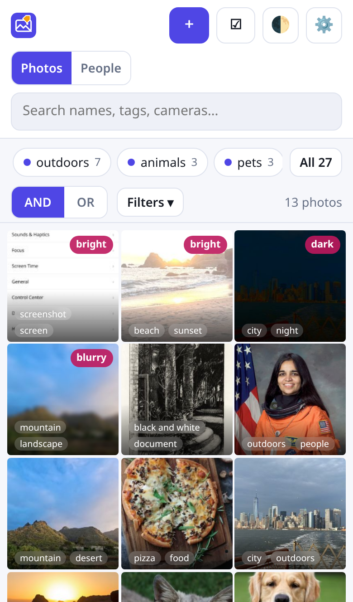
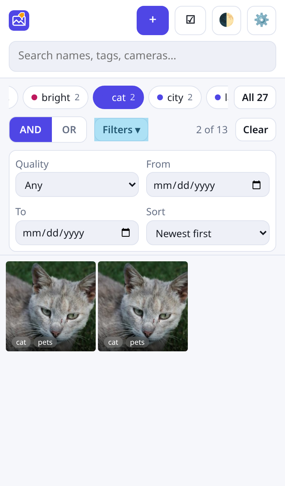
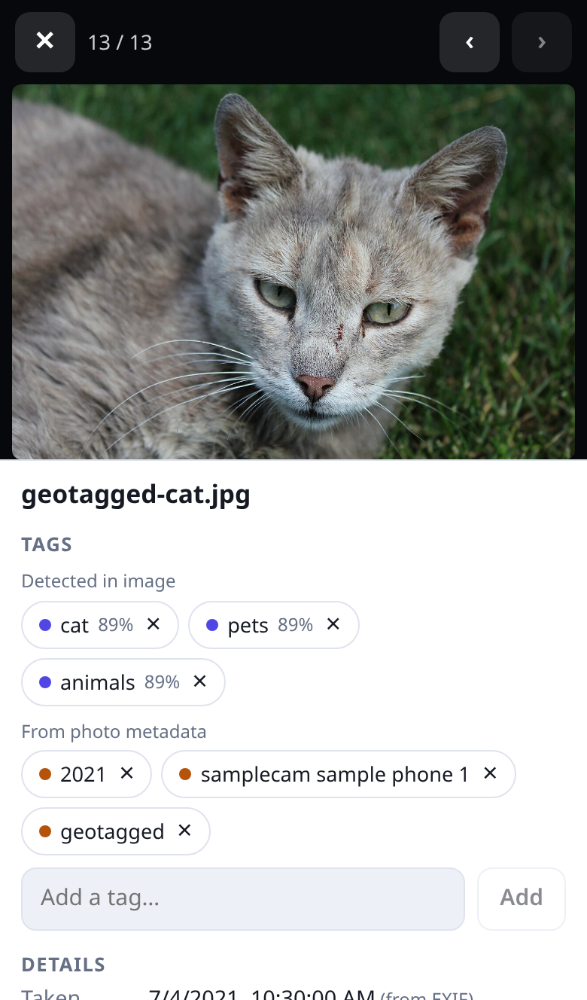
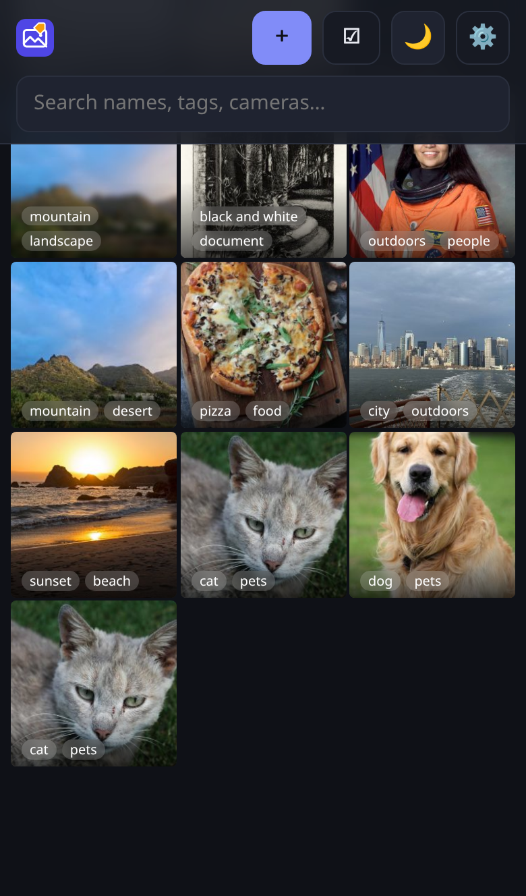
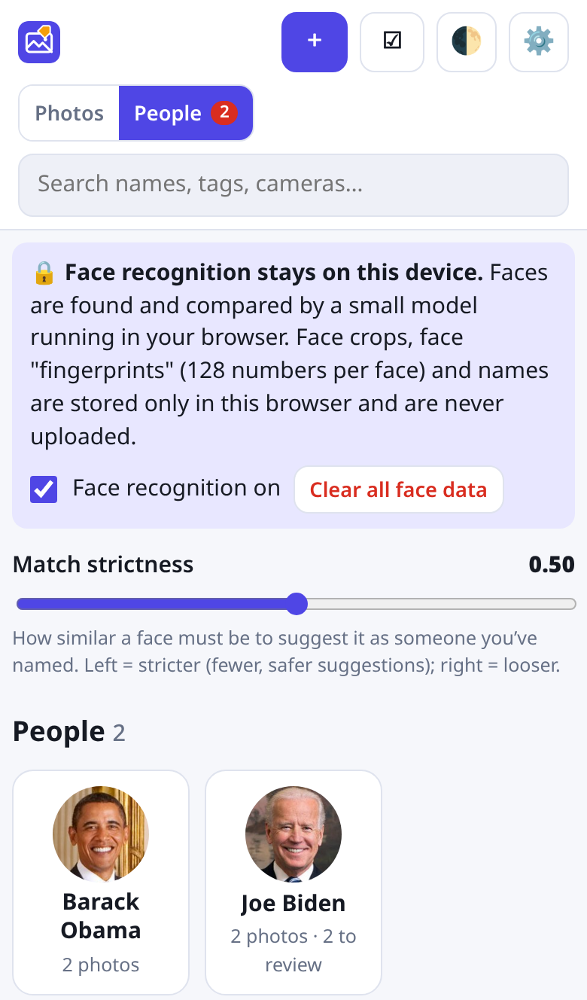
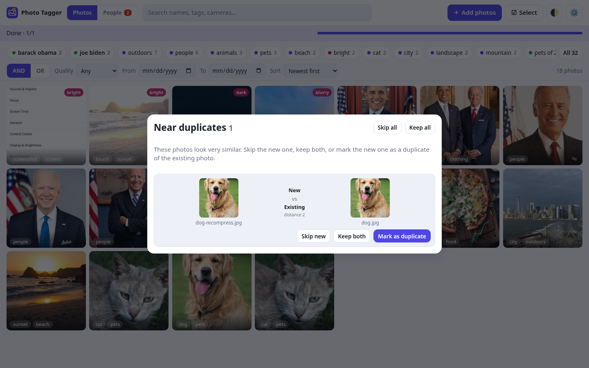
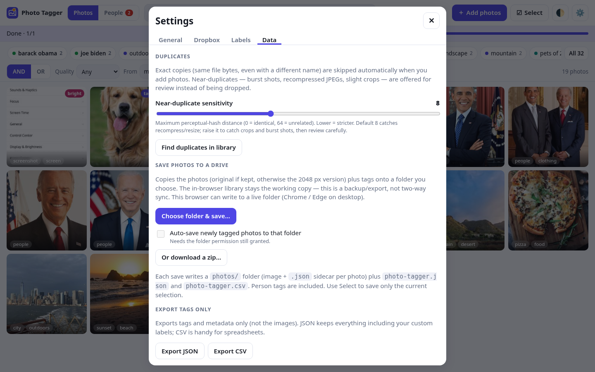

# Photo Tagger

**Live app: <https://cdrjohnson.github.io/photo-tagger/>** (open it on your phone or laptop; no sign-up, nothing is uploaded)

Bring in photos from your **phone, laptop and Dropbox**, have each one **tagged automatically from what's in it**, then **filter by tag** in a fast, clean interface. Everything runs **in your browser**: the AI model, the tagging and the storage. Your photos are tagged **on your device** — there is no server and no paid API key. If you connect Dropbox, Photo Tagger reads your photos through Dropbox's API and writes their tags back into your Dropbox — nothing about them is kept on your device.

It is an installable web app (PWA) – open it on your laptop or phone, then "install" it for a home-screen icon and offline use.

| Library | Filter by tags | Photo detail |
| --- | --- | --- |
|  |  |  |

<p>





</p>






## Features

- **Ingest**: file picker, drag-and-drop, paste, whole folders (desktop), camera roll **or camera** (phones), and **Dropbox as your library**: connect once (OAuth PKCE), browse your Dropbox folders in the app and tag them — photos are downloaded into memory only, and tags/face names are written to `/.photo-tagger/` in your Dropbox; nothing about Dropbox photos is stored locally; **Refresh Dropbox** tags only new photos (needs your own free app key – see [docs/DROPBOX_SETUP.md](docs/DROPBOX_SETUP.md)).
- **Automatic tags** from the image content with CLIP zero-shot classification over ~90 built-in labels (people, selfie, dog, cat, food, pizza, landscape, mountain, beach, city, night, document, receipt, screenshot, meme, art and more). Related tags are added automatically (dog → pets, animals).
- **Metadata tags** from EXIF: year taken, camera, and `geotagged` (GPS coordinates are shown on the photo with an OpenStreetMap link).
- **Quality checks**: `blurry`, `dark`, `bright` (thresholds adjustable).
- **Your own tags**: add or remove tags on one photo or on many at once. Tags you remove stay removed when you re-tag.
- **Your own vocabulary**: switch built-in labels off, or add custom labels ("lighthouse", "my dog Rex") and re-tag your whole library instantly.
- **Filter**: tag chips with counts, **AND / OR**, search box, date range, quality filter, sort. Counts update live as other filters change.
- **Multi-select** (checkbox, shift-click, long-press on phones) with bulk tag/untag, bulk export and bulk delete.
- **Face naming (People view)**, on-device: faces are found and fingerprinted in the browser, unnamed faces are **grouped into clusters**, and you **name a face or a whole cluster**. Photo Tagger then **suggests the same person in other photos** (naming one face in a mixed unnamed group moves look‑alike faces to the *Is this…?* review list — nothing is deleted), with a **match-strictness slider**. **Confirm or reject** each suggestion (or *Yes to all*); a rejection is remembered and never re-suggested. **Merge, rename and delete** people. Names become **person tags** (their own chip group, listed first) that you can **filter with AND / OR**, search, and that are included in exports. A **privacy toggle** turns recognition off, and **Clear all face data** deletes every face crop, fingerprint and name.
- **Duplicate detection**: a cheap `name|size|date` check first, then a **SHA-256 content hash** (exact copies with different names are skipped automatically) and a **64-bit dHash** perceptual hash. Near-duplicates (recompress, slight resize/crop, burst shots) open a **review** — skip, keep both, or mark as a duplicate — instead of being dropped silently. **Find duplicates** in Settings rescans the library; a **sensitivity slider** (default Hamming distance **8**) sets how close two photos must be.
- **Save photos to a drive**: on Chromium desktop, pick a folder with the File System Access API and write photos + `.json` sidecars + `photo-tagger.json` / `.csv` (person tags included). The folder handle can be remembered for **Save again** / optional auto-save. Elsewhere (Safari, Firefox, phones) download a **zip** of the same layout. This is a backup/export — the in-browser library stays the working copy.
- **Export / import tags** as **JSON** (everything, including custom labels) or **CSV**.
- **Storage** in IndexedDB: thumbnail + a 2048 px copy per photo (optionally the full original). Nothing is uploaded.
- **Responsive**, touch-friendly, **dark mode** (auto / light / dark), keyboard shortcuts in the detail view (←, →, Esc).


## Windows desktop app

For large libraries, use the **desktop app** (Tauri). Originals stay in a folder you choose; thumbnails, tags, faces and settings live in `<library>/.photo-tagger/` on disk — not in the browser’s IndexedDB quota.

Download from [Releases](https://github.com/cdrjohnson/photo-tagger/releases/tag/desktop-v1.0.3):

| Build | File | When to use |
| --- | --- | --- |
| **Installer** | `Photo.Tagger_*_x64-setup.exe` or `*.msi` | Normal PC install (current user; NSIS does not need admin) |
| **Portable** | `Photo.Tagger_*_x64_portable.zip` | USB drive or any folder — unzip and run `Photo Tagger.exe`, no installer |

1. **WebView2** is required (built into Windows 11 and most Windows 10).
2. Unsigned builds may show **SmartScreen** — More info → Run anyway.
3. On first launch, choose a **library folder**, or **Use folder next to the app** (creates `library/` beside the exe — ideal for portable).
4. **Portable** builds include a `portable.txt` marker so settings live in `data/` next to the exe (they travel with the folder). Installer builds use the normal app data location.
5. Adding photos from this device copies files into the library folder and tags each as it arrives. Dropbox photos are **not** copied and nothing about them goes into the local `.photo-tagger/` folder; their tags live in `/.photo-tagger/` inside Dropbox. Desktop Dropbox sign-in opens your browser and returns to `http://127.0.0.1:53682/`. The web app at <https://cdrjohnson.github.io/photo-tagger/> still works; browser libraries are **not** auto-migrated.

Linux and macOS desktop builds should be straightforward later (`tauri build` on those OSes); phone apps are a separate step.

Developers:

```bash
npm install
npm run tauri:dev      # needs Rust + platform WebView deps
npm run tauri:build    # produces installers under src-tauri/target/release/bundle/
```

## Quick start

Requirements: Node.js 20 or newer.

```bash
npm install
npm run dev          # http://localhost:5173/photo-tagger/
```

Production build and local preview:

```bash
npm run build        # type-checks, then builds to dist/
npm run preview      # http://127.0.0.1:4174/photo-tagger/
```

The first time you add a photo the app downloads the tagging model (~64 MB) from Hugging Face and caches it in the browser. After that tagging works offline.

### Run the tests

```bash
npx playwright install chromium     # once
npm run build
npm run test:e2e                    # 45 end-to-end tests in Chromium (incl. 9 for faces)
npm run screenshots                 # regenerates docs/images/*.png
node scripts/smoke-live.mjs         # smoke-test the deployed site (real network)
```

The e2e suite uses the real model and the sample photos in [`samples/`](samples/) (CC0 / public domain, see [`samples/ATTRIBUTION.md`](samples/ATTRIBUTION.md)). Model files are cached under `.model-cache/` after the first run so later runs are quick. Dropbox is exercised against a stubbed OAuth server and Dropbox API (a real key or account is not needed and none is used).

## Install on your phone (and laptop)

The live link above is already HTTPS. Installing needs the app to be served over **HTTPS** (browsers only allow service workers, install prompts and the model cache on secure origins). `http://192.168.x.x:5173/photo-tagger/` from your laptop will let you *try* the app on a phone, but it can't be installed and the model cache may not persist.

1. **Host it over HTTPS.** This repo already deploys to GitHub Pages (**Settings → Pages → Source: GitHub Actions**): the workflow in `.github/workflows/deploy.yml` builds and publishes every push to `main` at <https://cdrjohnson.github.io/photo-tagger/>. If you fork it under another name, set the base path to match (`BASE_PATH=/your-repo/ npm run build`, or edit the default in `vite.config.ts`). For another static host (Netlify, Cloudflare Pages, …) build with `BASE_PATH=/` and upload `dist/`.
2. **Open that address on your phone.**
   - **iPhone / iPad (Safari):** Share button → **Add to Home Screen**.
   - **Android (Chrome):** ⋮ menu → **Install app** (or *Add to Home screen*).
   - **Laptop (Chrome / Edge):** click the install icon at the right of the address bar.
3. Open it once while online and add a photo, so the model downloads. From then on it works offline.
4. Tip: on a phone, *Add photos → Choose photos* opens your camera roll (or Files), and *Take a photo* opens the camera.

Your library lives **per browser and per device** (it is stored in that browser's IndexedDB). To move tags between devices, use **Settings → Data → Export / Import** and add the same photos on both.

## How it works

| Step | Technology |
| --- | --- |
| Decode, thumbnails, EXIF, quality | Canvas + [exifr](https://github.com/MikeKovarik/exifr); blur = variance of the Laplacian (exposure-normalised), exposure = mean luma |
| Tagging model | **CLIP ViT-B/32** (OpenAI, MIT) via [Transformers.js](https://huggingface.co/docs/transformers.js) + ONNX Runtime Web (WebAssembly, in a Web Worker) |
| Zero-shot labels | Each label has a few text prompts ("a photo of a dog"…). Their text embeddings are **pre-computed at build time** (`npm run labels:embed`), so only the image tower is downloaded. A photo's image embedding is compared to every label, a softmax gives confidences, and labels above the threshold become tags |
| Re-tagging | Image embeddings are stored, so changing labels or the threshold re-tags the library instantly without re-running the model |
| Storage | IndexedDB (via `idb`): photos, thumbnails, 2048 px copies, embeddings, settings |
| Duplicates | Cheap fingerprint → SHA-256 of file bytes (exact) → **dHash** (9×8 greyscale, 64-bit) compared by Hamming distance (default ≤ 8). Near matches are queued for review; rejected “not a duplicate” pairs are remembered |
| Save to disk | File System Access API (`showDirectoryPicker`) when available; otherwise a store-method ZIP download. Writes `photos/<name>`, `photos/<name>.json`, `photo-tagger.json`, `photo-tagger.csv` |
| Faces | [`@vladmandic/face-api`](https://github.com/vladmandic/face-api) (MIT) on TensorFlow.js (WebGL, CPU fallback) in a Web Worker: SSD MobileNet v1 detector → 68-point landmarks → 128-number face descriptor. Faces are compared by Euclidean distance; unnamed faces are clustered (leader/centroid, 0.5) and each unknown face is suggested as the nearest confirmed person within the strictness threshold (default 0.5), skipping people you rejected for that face and people already confirmed in the same photo |
| PWA | `vite-plugin-pwa` (Workbox) precaches the app; ONNX Runtime wasm is served from the app's own origin and cached |

**Model and size.** `Xenova/clip-vit-base-patch32`, vision tower in 4-bit (`vision_model_q4.onnx`, **63.6 MB**), downloaded once from Hugging Face. Custom labels additionally load the text tower (`text_model_q4f16.onnx`, **72.5 MB**) the first time you add one. The ONNX Runtime wasm (14 MB) ships with the app.

**Face model and size.** `ssd_mobilenetv1` (5.6 MB) + `face_landmark_68` (0.36 MB) + `face_recognition` (6.4 MB) ≈ **12.4 MB**, shipped with the app (copied from the npm package at build time, served from the app's own origin) and fetched the first time faces are scanned. Licences: face-api code and model weights are MIT (vladmandic/face-api, from justadudewhohacks/face-api.js); the recognition net is a ResNet-34-like architecture modelled on dlib's face recognition network, trained and released by the face-api.js author under MIT.

**Privacy.** Face crops (160 px), face descriptors and names are stored only in this browser's IndexedDB, never uploaded. Turn recognition off in the People view to stop scanning new photos; *Clear all face data* deletes it all (photos and other tags are kept).

**Privacy (photos).** Tagging and face recognition run on your device; thumbnails, tags, embeddings and face data never leave it. The only network requests are: the one-time model download (Hugging Face); when *you* connect Dropbox, calls to Dropbox's API to sign in, list the folders you browse and download the images you tag or export (straight from Dropbox to the app, no other server); and OpenStreetMap when you click a location link. Each Dropbox photo is downloaded into memory only, to tag it and find faces, then discarded. Tags, face names and face/CLIP data for Dropbox photos are written into your Dropbox (`/.photo-tagger/`), not to this device; only the app key, the Dropbox sign-in tokens, linked-folder list and settings are stored locally. Photo Tagger never modifies or deletes your photos in Dropbox — it writes/deletes only its own files in `/.photo-tagger/`.

## Limits worth knowing

- **First tag is slow, later ones are fast.** The model is ~64 MB and must be downloaded and initialised once (a few seconds on broadband; longer on mobile data). Tagging then took about **0.5 s per photo** (including decoding, thumbnails and EXIF) in headless Chromium on the 8-core machine used to build this. Phones are slower – I have not measured one, but expect a few times that – and the work runs in a background worker so the interface stays responsive.
- **Dropbox needs your own app key** with the scopes `files.metadata.read`, `files.content.read`, `files.content.write`, `account_info.read`, redirect URIs, and *Full Dropbox* access to see your real folders ([setup guide](docs/DROPBOX_SETUP.md)). Browsing, tagging new Dropbox photos and exporting their originals need an internet connection; Dropbox photos are not available offline (nothing is stored locally).
- **CLIP is a general-purpose model**: it is great at scenes and common objects, weaker on fine detail (breeds, small text) and sometimes picks a plausible-but-wrong neighbour. Adjust the confidence slider, edit tags by hand, or add custom labels.
- **Browser storage**: browsers limit how much a site may store. By default only a 2048 px copy + thumbnail is kept per photo (≈0.3–1 MB each); turn on *Keep full-size originals* if you need them. Clearing site data erases the library.
- **HEIC** photos are only readable where the browser can decode them (Safari/iOS convert them to JPEG when you pick from the camera roll; desktop Chrome cannot decode HEIC).
- **Near-duplicate detection is perceptual, not perfect.** Default distance 8 catches recompressed/resized copies of the same shot; crops and burst frames often need 10–12. Unrelated photos in this project’s samples scored ≥ 24 apart. Flat UI screenshots can look alike at 9×8 — raise caution when reviewing those.
- **Face recognition is good, not perfect.** On the test portraits, the same person scored 0.30–0.47 apart and different people ≥ 0.73, so the 0.5 default separated them cleanly. But candid shots with a turned head, profile, strong lighting or many years' difference scored 0.61–0.77 for the same person (so they are *not* suggested at 0.5 – name them by hand or move the slider right and review). The detector also sometimes finds a "face" on a pet (it found the cat in the samples); tap **×** to ignore it. Small faces in group photos (< ~40 px) may be missed. Face scanning adds roughly **2–3 s per photo** in headless Chromium (CPU); clustering compares every face with every cluster, so very large libraries (many thousands of faces) will make the People view slower.
- Single-threaded WebAssembly is used (static hosts such as GitHub Pages cannot send the headers that multi-threading needs). WebGPU is not used yet.

## Project layout

```
src/            React + TypeScript app (App.tsx, store.tsx, components/)
src/ml/         CLIP web worker, client, pre-computed label embeddings
src/labels.ts   the built-in label vocabulary (edit, then `npm run labels:embed`)
scripts/        e2e tests, screenshots, sample fetcher, icon + embedding generators
samples/        public-domain test photos (+ ATTRIBUTION.md)
docs/           user guide, Dropbox setup, screenshots
```

To change the built-in labels: edit `src/labels.ts`, run `npm run labels:embed` (downloads the full-precision text model once, in Node) and rebuild.

## Documentation

- [User guide](docs/USER_GUIDE.md)
- [Dropbox setup](docs/DROPBOX_SETUP.md)

## License

[MIT](LICENSE) © 2026 cdrjohnson. Third-party components and the CLIP model are listed in [NOTICE](NOTICE).

### Runtime packaging regression checks

Both production build commands validate the copied ONNX module's complete local
import/binary graph against the installed runtime, reject HTML or invalid WASM,
and check bundled fallback WASM references. Do not prune Vite-emitted runtime assets.

```sh
VITE_TAURI=1 TAURI_ENV_PLATFORM=windows npm run build:tauri
npm run test:ort                  # real CLIP worker, clean + poisoned old runtime cache
npm run build
node scripts/test-ort.mjs --web    # same inference tests under /photo-tagger/
npm run test:e2e                  # includes failed import + fresh-worker Retry tagging
```

The local runtime bypasses Transformers' persistent WASM cache (AI model caching
is unchanged). This repairs upgrades from builds which cached an HTML fallback
as `ort-wasm-simd-threaded.mjs` / `.wasm`. Only runtime assets get an ORT-version
query key, so stale HTTP/service-worker caches cannot shadow an updated runtime.
