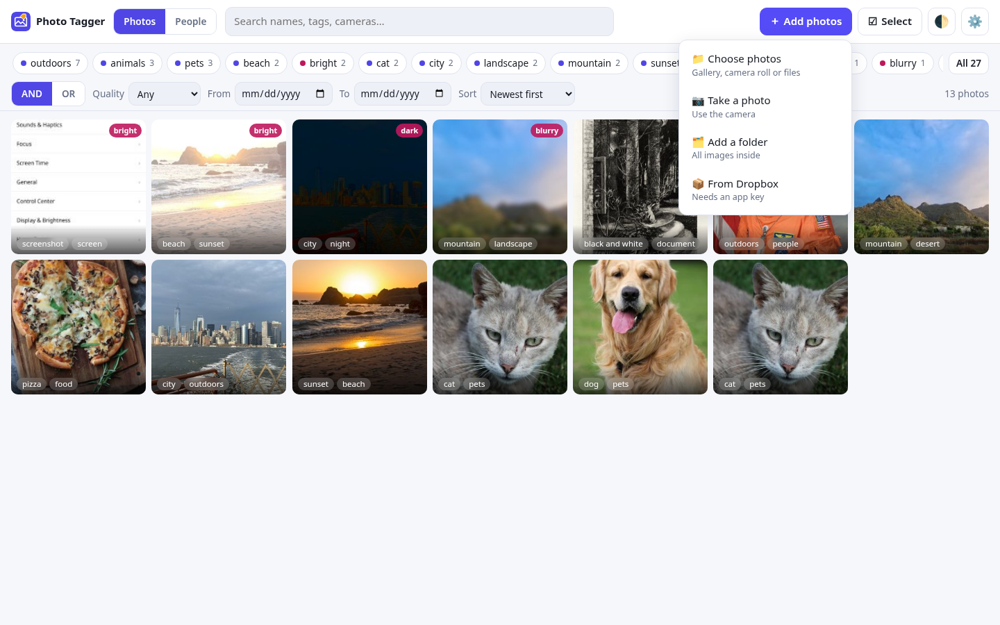
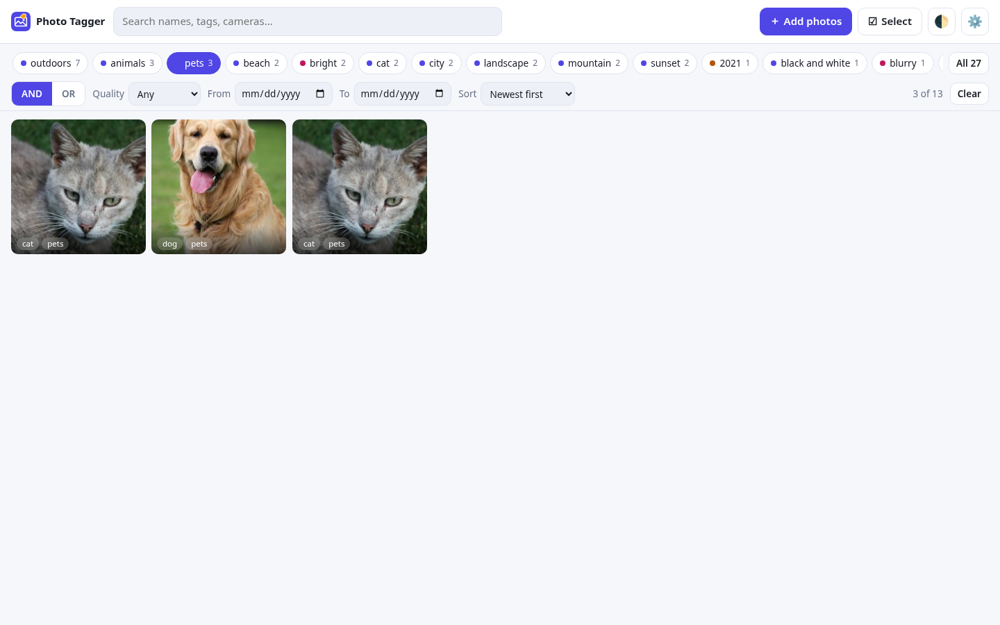
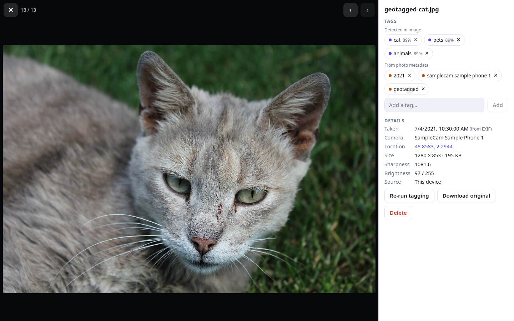
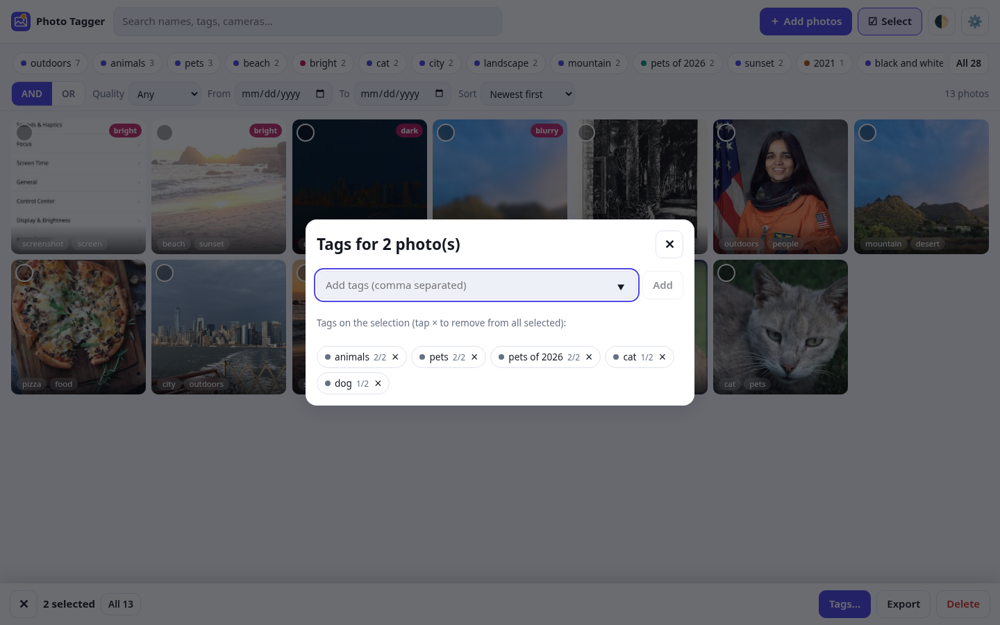
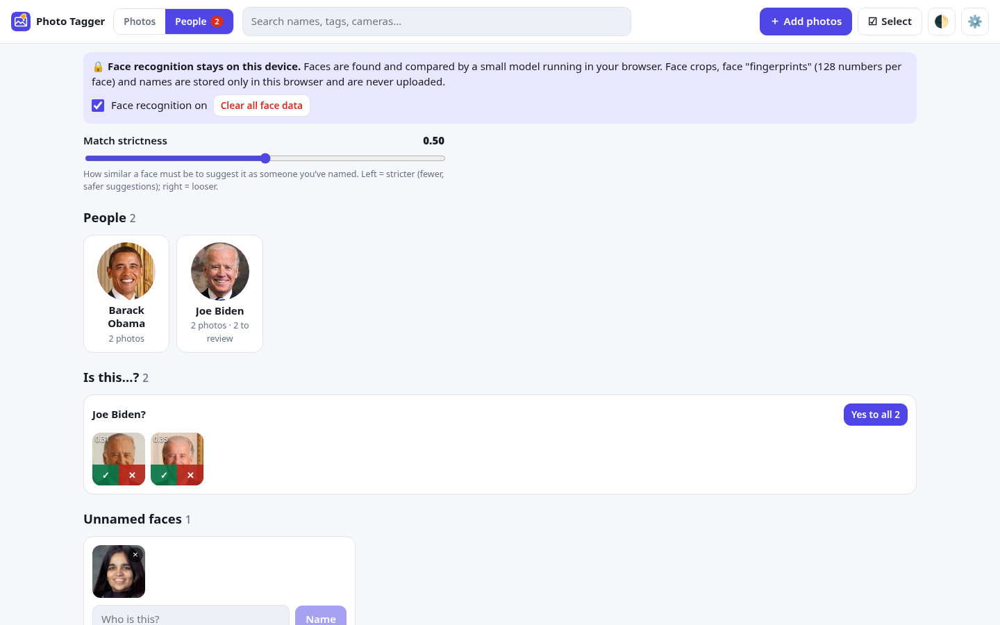
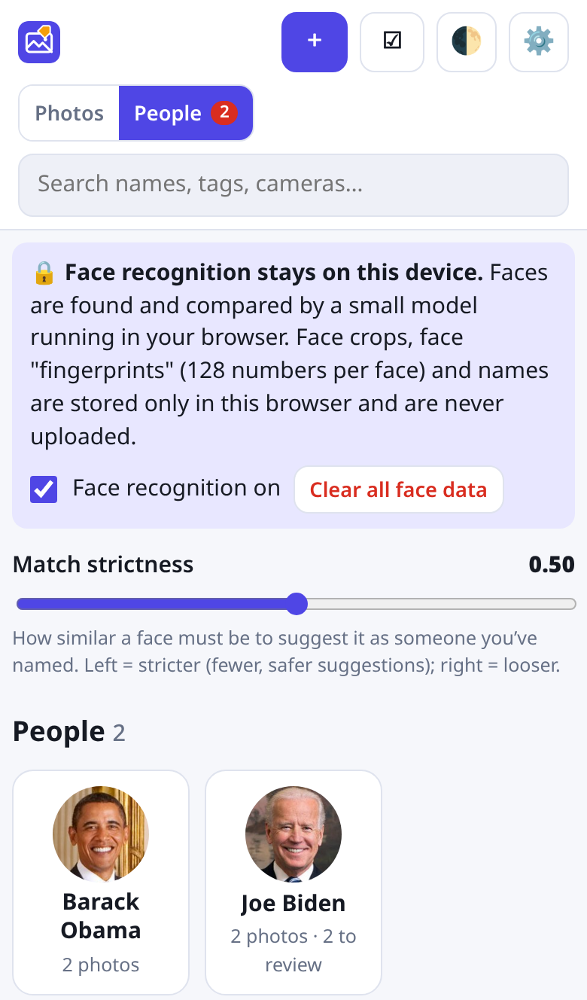
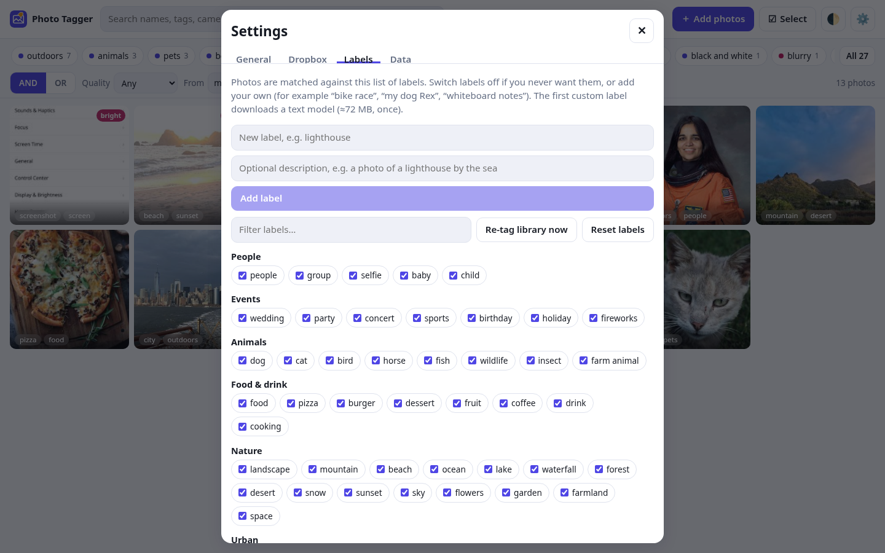

## Windows desktop app

Use the desktop build when your library is too large for a browser tab. Both an **installer** and a **portable zip** are published on [GitHub Releases](https://github.com/cdrjohnson/photo-tagger/releases/tag/desktop-v1.0.3).

### Installer
1. Download `Photo.Tagger_*_x64-setup.exe` (NSIS) or the `.msi`.
2. Run the installer (NSIS current-user mode does not need admin).
3. Open **Photo Tagger**.

### Portable (no install)
1. Download `Photo.Tagger_*_x64_portable.zip`.
2. Unzip anywhere (USB stick, Desktop, Documents).
3. Run `Photo Tagger.exe`. A `portable.txt` file in the folder makes settings live in `data/` beside the exe so they travel with the folder.
4. On first launch, click **Use folder next to the app** to use the included `library/` folder, or choose any other folder.

### Shared notes
1. **WebView2** is required (Windows 11 and most Windows 10 already have it).
2. Unsigned builds may trigger **SmartScreen** — More info → Run anyway. We do not ship a code-signing certificate.
3. Photo Tagger copies new photos from this device into your library folder and stores metadata under `.photo-tagger/` inside it. Dropbox photos are not copied and nothing about them is written locally — their tags and faces are saved in `/.photo-tagger/` inside your Dropbox.
4. Connect Dropbox in Settings → Dropbox: your browser opens dropbox.com, you click Allow, and the app picks it up via `http://127.0.0.1:53682/`. Cancel + confirm for Dropbox works the same as on the web: already-added photos stay in the library.
5. “Save to folder” from the web app is unnecessary on desktop — your library folder *is* that location. You can still download a zip backup from Settings → Data.
6. Existing data from the **browser/PWA** is not imported automatically; add photos again (or copy files into the library folder and re-ingest).

Linux/macOS desktop ports are expected to reuse the same Tauri project later. iPhone/Android are out of scope for now.

# Photo Tagger – user guide

Photo Tagger looks at each photo, writes down what's in it as **tags** ("dog", "beach", "document"…), and lets you find photos by combining those tags. It all happens on your own device: **your photos are never uploaded**.

## 1. Add photos

Click **＋ Add photos** (top right) — one click opens the Dropbox browser (or Dropbox setup if you haven't connected yet; the line under the button says which). Once you've tagged Dropbox folders, a separate **↻ Refresh** button next to it re-checks them for new photos:

Photos are added **from Dropbox** only (since 1.0.17 there's no Choose photos / Take a photo / Add a folder / drag-and-drop). Photos you added from this device in earlier versions stay in the app until you remove them.

| Option | What it does |
| --- | --- |
| **From Dropbox** | Opens Photo Tagger's own Dropbox browser (after a one-time connect: see [Dropbox setup](DROPBOX_SETUP.md)). Browse folders with the breadcrumbs, then **Tag new photos here** (tick **Include subfolders** for everything below). To bring in only some photos, pick them like in a file manager: click one, **Ctrl/⌘-click** to add or remove others, **Shift-click** for a range (Shift-clicking an already selected photo deselects that range), or **drag** down the list; **Select all** (or Ctrl/⌘+A) and **Deselect all** are above the button, which then reads **Tag N selected photo(s)** — only those are tagged, subfolders aren't included, and the folder is not added to the linked folders that **Refresh** re-checks. Each photo row shows a small Dropbox preview (loaded as you scroll), its date and size; photos already in the library show a greyed, ticked box and **Already in library**. **Videos** (mp4, mov, m4v, avi, mkv, webm, wmv, mpg) are listed too and tagged from Dropbox's preview frame only — the video itself is never downloaded; a video Dropbox has no preview for yet is skipped with a message, and **Download original** is off for videos (open them in Dropbox). The banner tracks progress (n/N, Cancel). Photos are downloaded into memory only; tags and faces are written to `/.photo-tagger/` in your Dropbox, nothing is stored on this device. |
| **↻ Refresh** (header button, also inside the Dropbox browser) | Re-checks the Dropbox folders you've tagged before and tags only photos that are new since last time. |

### Check your detection list first (first import)

When your library is **empty** and you start an import from Dropbox (**Tag new photos here**, **Tag N selected**, **Add next batch**, **Add all remaining**, the resume banner or **↻ Refresh**), Photo Tagger first asks **“Check your detection list first”** — before anything is downloaded or analysed. It explains that every imported photo automatically gets tags from your **Detection list** and **Photo metadata** settings (and that they're saved to Dropbox), with a short summary: how many built-in detection tags are on, your custom detection tags, which metadata tags (Year, Camera, Geotagged, Blurry, Dark, Bright) are on or off, and whether face recognition is on.

- **Review detection list** (focused by default, so Enter never starts an import) opens **Settings → Tags** scrolled to the **Detection list** card. The import does not start; start it again when you're happy.
- **Tag with these settings** starts the import.
- **Cancel** (or Esc / ✕) does nothing.
- **Don't show this again** stops the question. Turn it back on in **Settings → Dropbox → Imports → Ask me to check the detection list before the first import**.

It only appears while the library has no photos — never for imports into a library that already has photos.

### Large folders: batches and folder progress

Big imports are done in **batches** (Settings → Dropbox → **Photos per batch**, default 100, 10–500). Each batch is tagged (three photos at a time), then Photo Tagger waits until that batch's tags are **saved to Dropbox**, **verifies** them by reading them back from Dropbox, and only then starts the next batch. The banner shows where it is: **“Batch 2 of 7 · tagging 37 of 100”**, **“Batch 2 of 7 · saving tags to Dropbox…”**, **“Batch 2 of 7 · verifying…”**. Photos whose tags didn't fully land (missing, 20-tag limit, errors) are added to the Dropbox save list (**View** / **Retry now**, see below). **Cancel** stops before the next batch; finished photos stay. Imports at or below the batch size run as one batch and are verified too.

In the Dropbox browser every folder row (and the **This folder** line for the open folder) shows how much of it is in your library — e.g. **“1,200 of 2,000 in library (this folder only)”** or **“All in library”** — counted from Dropbox's file list only (nothing is downloaded). Counts follow **Include subfolders** (“incl. subfolders” / “this folder only”) and include videos; files that were skipped (no video preview yet, duplicates) are shown as skipped and don't stop a folder from reading **All in library**. **Add next batch (N)** adds the next N photos not yet in the library, in name order; **Add all remaining** adds the rest in batches.

If the app is closed in the middle of a folder import, the next time you open it a banner says e.g. **“Import of /Photos/2019 stopped at 1,200 of 2,000. Continue?”** — **Continue** adds the remaining photos, **Dismiss** forgets it. (Tag saves that were still queued resume on their own.)

The first time, the app downloads its tagging model (about 64 MB) – a progress bar shows this. It is stored in the browser, so this only happens once. Photos you add again later (same name, size and date) are skipped as duplicates.

While a photo is being processed its tile shows *tagging…*; tags appear a moment later. Videos carry a teal **▶ video** badge in the tile's top-right corner (above any *duplicate* or *blurry/dark/bright* badge); photos have no badge.

## 2. What the tags mean

Each photo can carry four kinds of tags, shown with a coloured dot:

- 🟣 **Detected in image** – found by the AI (for example `dog`, `pets`, `beach`, `city`, `screenshot`). In the detail view each shows its confidence.
- 🟢 **Added by you** – tags you typed yourself.
- 🟠 **From photo metadata** – the year it was taken, the camera, and `geotagged` if the photo has GPS coordinates.
- 🔴 **Quality check** – `blurry`, `dark` or `bright`.

## 3. Find photos

- **Tag chips** (below the search bar) – tap one or more. The number on each chip is how many photos have it *given your other filters*. **All 27** (the number varies) shows every tag.
- **AND / OR** – with **AND** a photo must have *all* selected tags (`pets` AND `geotagged`); with **OR** it needs *any* of them.
- **Search** – matches file names, tag names and camera models ("pizza", "iphone").
- **Quality** – *Good only* hides blurry/dark/bright photos; or show just one of those kinds (handy for clean-up).
- **From / To** – date range, using the date the photo was taken (EXIF) or the file date if there isn't one.
- **Sort** – newest, oldest, recently added or by name.
- **Clear** resets the filters.

On a phone, the date, quality and sort controls fold into the **Filters ▾** button.

## 4. Look at one photo

Tap a photo to open it. From here you can:

- **Add a tag**: type in the box and press Enter (separate several with commas). The box suggests **every tag already in your library** (plus your own Settings → Tags entries), filtered as you type — use ↑/↓ and Enter, or click one. A close spelling reuses the existing tag: typing “family trip” or “Family-Trip” adds your existing `family_trip` instead of creating a second tag for the same topic.
- **Remove a tag**: tap the **×** on it. A detected tag you remove will not come back when you re-tag.
- See the **date, camera, GPS location** (tap the coordinates to open a map), size, sharpness and brightness.
- Move between photos with ‹ › (or the ← → keys). **Esc** closes.
- **Zoom** to inspect detail: **＋ / −** buttons, the slider, mouse wheel, or pinch on a touch screen. Drag to pan when zoomed in. The percentage is the real size (100% = actual pixels), so large photos open well below 100% and you can zoom out further than that to shrink a photo. **0** or the percentage button fits the whole photo in the frame again (the default). Every photo, however large, tall, or wide, opens fitted so nothing is clipped.
- **Re-run tagging** (re-analyzes the photo and updates detected tags — not faces; for Dropbox photos it also picks up tag changes made in Dropbox and saves tags back; not needed after editing a tag chip, which already updates Dropbox), **Download** (the original if kept, otherwise the stored copy) or **Remove from app** (this only removes it from Photo Tagger; the photo itself, in Dropbox or elsewhere, isn't deleted). The **Re-run tagging** explanation sits directly under that button.

## 5. Work on many photos at once

Tap **Select** (or press and hold a photo on a phone, or tick the circle that appears on a tile). On a computer, **Shift-click** selects a range — or, if the photo you Shift-click is already selected, deselects that range. **None** (next to **All**) clears the selection but keeps you in select mode; **✕** leaves select mode.

The bar at the bottom lets you **Select all** photos matching the current filter, edit **Tags…** (add tags to all selected photos, or remove a tag from all of them), **Export** just those photos' tags, or **Remove from app** (removes them from Photo Tagger only; the photos themselves aren't deleted). Remove from app always asks first in a small dialog — **Cancel** is the default, so nothing is removed until you click **Remove from app** there.

## 6. People (face naming)

**Photo tiles** show two tags — **named people first**, then your own, detected or Dropbox tags, then date/camera or quality to fill both slots (a photo with only two tags shows both). Only when there are more than two does a **+N** button on the tile opens a list of the rest (people, dates/camera, quality, Dropbox, your own and detected tags). Remove any of them with **×** right there without opening the photo; Escape or a click elsewhere closes it. Add new tags in the photo's detail panel.

Open the **People** tab at the top. The red badge counts suggestions waiting for you.

- **Everything stays on this device.** Faces are found and compared by a ~12 MB model that runs in your browser. Face crops, face "fingerprints" (128 numbers per face) and names are kept only in this browser.
- **Find faces**: new photos are checked automatically. Photos added while recognition was off show a **Find faces** button.
- **Unnamed faces** are grouped – faces that look like the same person sit together. Type a name under a group and press **Name** to name them all, or tap individual faces first to name only those. The name box suggests existing people first, then your tags from Dropbox, tags you added, and detected tags (not dates, cameras or quality tags) — pick one to reuse it. A typed name that differs only by case, spaces or underscores ("Family Trip" vs `family_trip`) reuses the existing spelling, so you don't get duplicates. Tap **×** on something that isn't a face (or someone you don't want to name) to ignore it.
- **Is this…?** After you name someone, other faces that look like them are suggested. Each suggested face is shown larger, with **✓** (yes) and **✕** (no) directly below it so they don't cover the face; tap one, or **Yes to all**. A "no" is remembered: that face will not be suggested as that person again.
- **Match strictness**: move the slider left for fewer, safer suggestions, right to catch more (e.g. older photos or side views) – then review more carefully.
- **A person**: tap their card to see their faces, remove a wrong one (**×**), **Show photos**, **Rename**, **Merge into** another person (if you named someone twice), or **Delete person** (their faces go back to Unnamed; the photos are kept). Renaming to an existing name merges the two.
- **Person tags**: each named person becomes a tag (in its own colour, listed first in the chip bar). Filter with it like any tag – pick two people with **AND** for photos of both together, **OR** for either. Removing a person tag from a photo (in the photo or with bulk edit) tells the app that face isn't them.
- **Exports** (JSON / CSV) include person tags. Importing turns them into ordinary tags.
- **Privacy controls**: untick **Face recognition on** to stop checking new photos; **Clear all face data** (tap twice) deletes all faces, fingerprints, names and person tags.

On a phone the People view works the same way:

## 7. Settings

Open **⚙️**.

### General
- **Confidence needed for a tag** – lower gives more tags per photo (and more mistakes); higher gives fewer, safer tags.
- **Maximum auto-tags per photo.**
- **Blur / Dark / Bright thresholds** – decide when the quality tags appear. For example, raise the blur threshold to flag more photos as blurry.
- **Keep full-size originals** – off by default to save space (each photo is stored as a 2048 px copy plus a thumbnail).
- **Model** – shows whether the model is loaded; you can download it ahead of time (handy on Wi-Fi before you travel).

Settings save as you change them and apply to newly added photos right away. Existing photos keep their current tags until you click **Re-tag library now** (Settings → Tags → Detection list), or **Re-run tagging** on a single photo. Closing Settings never starts a re-tag job.

### Dropbox
Paste your Dropbox **app key**, then **Connect Dropbox** (see [Dropbox setup](DROPBOX_SETUP.md) — it lists the redirect URIs and the scopes `files.metadata.read`, `files.content.read`, `files.content.write` (only for Photo Tagger's own `/.photo-tagger/` files), `files.metadata.write` (Dropbox tags on your photos), `account_info.read` to add to your Dropbox app; use **Full Dropbox** access to browse your real folders). The tab shows who is connected and a **Disconnect** button that forgets the sign-in on this device.

While tagging a Dropbox folder, watch the **banner under the header**: “Tagging from Dropbox · n/N” with **Cancel**. Up to three photos download at a time, each only into memory; it is tagged and face-scanned, its tags/faces are written to `/.photo-tagger/` in your Dropbox, its tags and people's names are added to the photo as Dropbox tags (searchable in Dropbox; kept in sync when you add or remove tags, ). Tags a photo already has in Dropbox (e.g. `family_trip`) are imported when you tag or refresh it and show in the detail panel under **From Dropbox** (tags Photo Tagger made — detected, added by you, people, photo metadata — keep their own groups, even after they're written to Dropbox). They're editable: removing one in Photo Tagger removes it from the file in Dropbox too. Tags you add or remove in Dropbox are picked up when you **open the photo**, **Refresh Dropbox**, **Re-run tagging** / **Re-tag library**, or reconnect — no re-download needed (**Download original** only fetches the file; it does not refresh tags). Dropbox tags are shown even when their spelling differs only by capitals, spaces or punctuation — “Family Trip” or “#family-trip” appears as `family_trip`, the form Dropbox search matches. **Re-run tagging** (photo detail) re-analyzes the photo and updates its detected tags; it doesn't re-scan faces. For a Dropbox photo it first picks up tag changes made in Dropbox, then saves Photo Tagger's tags back. You don't need it after adding or removing a tag chip — that already updates Dropbox right away (if Dropbox's web file info still shows an old tag, refresh that page; its info panel can be cached). **Re-tag library** (Settings) does the same for every photo. Re-run tagging shows a progress banner and then “Re-tagged …” or an error (for Dropbox photos it briefly downloads the picture into memory to re-score it); **Download original** shows “Downloading…”, then “Downloaded …” or an error if the file couldn't be fetched. A tag you remove in Dropbox stays removed: Photo Tagger drops it here too and never writes it back (a detected tag won't be re-detected; a person's name stays on their faces in People but isn't put back on the file) until you add that tag again in Photo Tagger or Dropbox. Dropbox allows 20 tags per file: tags added by you in Dropbox or by other apps always keep their place, and the remaining slots go to people, your own tags, then the most confident detected tags, so a newly added tag still syncs on a full photo), and the bytes are dropped. After upgrading from 1.0.7, enable `files.metadata.write` in your Dropbox app and Disconnect/Connect once. Nothing about Dropbox photos is stored on this device — only the app key, sign-in, linked folders, settings and (while saving) the short list of unsaved tag edits described below. Network hiccups are retried; anything still failing is summarised in one toast. **Cancel** asks to confirm: remaining work stops, photos already added stay.

Dropbox photos show Dropbox's thumbnails (fetched live, kept in memory). **Download original** / Save fetches the original from Dropbox at that moment. **Remove from app** deletes only Photo Tagger's tag file in `/.photo-tagger/` — never the photo. Face recognition (People) works on Dropbox photos exactly like on others.

### Saving tags to Dropbox (progress, retries, failures)

Tag edits show in Photo Tagger immediately and are written to Dropbox in the background, two photos at a time. While that runs, a bar under the header reads **“Saving tags to Dropbox: 37 of 120 photos · 83 remaining”** (plus **retrying N (reason)** when Dropbox is slow); it disappears when everything has landed. You can keep working meanwhile.

- **Temporary problems** — Dropbox rate limiting (429), server errors (5xx), “too many write operations”, network drops and timeouts — are retried automatically with growing, randomized waits, honoring Dropbox's Retry-After, and every request slows down while Dropbox is rate limiting. An expired sign-in is refreshed and the write continues. A photo is only listed as failed after it has kept failing for **30 minutes**.
- **Problems that retrying can't fix** go straight to the list: missing permission (`files.metadata.write` / Full Dropbox — fix it in your Dropbox app, then Disconnect/Connect), file not found in Dropbox (moved or deleted), a file that already has **20 tags** (names the tags that didn't fit), or an expired sign-in that can't be refreshed.
- The bar then shows **“⚠ N photos could not be fully saved to Dropbox”** with **View** (the list: each photo, the reason, and a Retry button) and **Retry now** (tries them all again). **Dismiss list** hides it.
- **Closing the app mid-save is safe:** unsaved edits (just photo ids and their tags, a few hundred bytes each) are kept on this device and the save resumes the next time you open Photo Tagger and Dropbox loads. In the browser you also get a “leave site?” warning while a save is running.
- **Verify Dropbox tags** first pushes everything queued; a photo that is still retrying is marked “Still saving to Dropbox — retrying (…)” in the results.

### Verify Dropbox tags

To check what really reached Dropbox, select photos and click **Verify Dropbox tags** in the selection bar. Or go to **Settings → Tags → Tags in your library → Verify Dropbox tags — whole library** to check every Dropbox-backed photo/video. The check first saves pending edits, then reads Dropbox's Tags API (no photo or video downloads). Dropbox's web file-info panel can be cached; the API read-back is the source of truth for this check.

Results stay in a searchable list, with **Only missing tags / errors** to focus on problems. Each file shows **Landed**, **Missing**, and, when its 20 native tag slots are full, **Could not be written because the file already has 20 tags**. Tags added by you or other apps keep their slots. Suppressed tags you removed in Dropbox are not expected or reported missing. If everything matches, it says **Every desired tag was found on Dropbox**. Non-Dropbox photos in a selection are skipped. Errors stay in the list; a permissions error explains the **files.metadata.write / Full Dropbox** requirement and reconnect steps. Verification reports what was read at that moment — it does not re-tag photos or force missing tags onto the file.

### Tags (the vocabulary)

Settings → **Tags** has two cards on one page. **Tags in your library** (first card, *On your photos*) lists **every** tag already on your photos — people, your own, detected, Dropbox, date/camera and quality tags — A–Z with how many photos have each, plus tags you've added to the list but not used yet. The whole list is shown; just scroll the Settings page (there is no small inner box to scroll). Search it to review your tags or spot near-duplicates; **Add to list** puts a new tag in the add-tag suggestions (and lets detection look for it); **Rename** changes a tag on every photo that has it (and in Dropbox) after you confirm — renaming to a close spelling of another tag ("family trip" → `family_trip`) merges the two. **Renaming a person's tag** renames that person (same as on the People page) and updates their photos; renaming to an existing person's name merges them. Reset detection list never changes tags on your photos.

The second card, **Detection list** (*What the app can find*), holds the tags Photo Tagger *can* detect automatically — not the tags already on your photos (the same word, e.g. `beach`, can appear in both). You can:
- **Photo metadata** (first group): **Year**, **Camera**, **Geotagged**, **Blurry**, **Dark**, **Bright** — all on by default. Switch one off and that tag is no longer added, and **Re-tag library** / **Re-run tagging** removes it from existing photos; switch it back on and re-tag to re-apply it. Closing Settings only saves your list — it does not change existing photos. Dates, camera, GPS, sorting, the detail panel, the quality badges and the quality filter keep working either way.
- **Switch tags off** you don't want (for example `wedding`).
- **Add a detection tag**: type a name ("lighthouse", "bike race", "my dog Rex") and, if you like, a short description such as *a photo of a lighthouse by the sea* – a good description improves accuracy. The first custom tag downloads a small text model (about 72 MB, once).
- **Re-tag library now** explicitly applies the saved list to existing photos; changes are not applied just by closing Settings. This is quick, because the app remembers what each photo "looks like".
- **Filter detection tags…** narrows the chips; **Reset detection list** puts the built-in list back, turns every Photo metadata chip on and removes your custom detection tags (it doesn't remove tags already on your photos).

### Data

- **Duplicates** – exact copies (same bytes, even renamed) are skipped when you add photos. Near-duplicates open a review: **Skip new**, **Keep both**, or **Mark as duplicate**. **Find duplicates in library** scans what you already have. The **Near-duplicate sensitivity** slider (0–20, default 8) is the maximum dHash distance; lower = stricter.
- **Save photos to a drive** – copies the photos (original if kept, otherwise the 2048 px version) plus tags onto disk. On Chrome/Edge desktop you pick a folder (remembered for next time; optional auto-save of newly tagged photos). On Safari, Firefox and phones you get a **zip** download instead. Layout: `photos/` with each image and a `.json` sidecar, plus `photo-tagger.json` and `photo-tagger.csv`. The in-browser library remains the working copy — this is backup/export, not two-way sync. Use **Select** to save only the current selection.
- **Export tags** – JSON or CSV of tags and metadata only (not the images). JSON keeps custom tags; CSV is handy for spreadsheets.
- **Import tags** – matches photos by file name (and size). Add the photos first, then import.
- **Delete all local data** – wipes this app’s IndexedDB in this browser (your originals elsewhere are untouched).

- **Export JSON / CSV** – saves every photo's tags and metadata (not the images). JSON also keeps your custom tags.
- **Import JSON or CSV** – add the photos to the app first, then import. Photos are matched by file name (and size); tags are merged with the ones already there. CSV needs `name` and `tags` columns, tags separated by `;`.
- **Delete all local data** – wipes this app's photos, tags and settings from this browser (asks you to click twice).

## 8. Install it as an app

If the app is served from an https address (see the README):

- **iPhone / iPad:** Safari → Share → *Add to Home Screen*.
- **Android:** Chrome → ⋮ → *Install app*.
- **Computer:** click the install icon in the address bar.

Once installed and used once online, it works offline. Use **🌓** (top right) to switch between automatic, light and dark themes.

## 9. Tips and troubleshooting

| Problem | What to try |
| --- | --- |
| "Tagging model unavailable" | The model couldn't download (offline?). Photos are kept untagged – connect, then tap **Retry tagging** in the banner. |
| "Face detection unavailable" / HTML JSON error | Face models (~12 MB) ship with the app. On desktop, reinstall the latest build if you see this once (photos still import and tag; face naming is skipped). Only one toast is shown — not one per photo. |
| A tag is wrong | Remove it with ×. Lower-confidence mistakes disappear if you raise *Confidence needed for a tag*. |
| A photo is missing tags it should have | Lower the confidence threshold, or add a custom label for it. |
| A photo won't import | The browser may not be able to read that format (for example HEIC on desktop Chrome). Convert to JPEG first. |
| Photos disappeared | Browser data was cleared, or you opened the app in a different browser/profile – each has its own library. Export your tags regularly. |
| Dropbox says “Invalid redirect_uri” | Add the exact Redirect URI from Settings → Dropbox to your Dropbox app ([steps](DROPBOX_SETUP.md)). |
| Dropbox browser only shows an empty folder | Your Dropbox app has *App folder* access; create a *Full Dropbox* app. |
| Slow tagging on a phone | Keep the screen on and the app open while it works; photos are processed one by one. |

### Desktop tagging error after upgrading

If an older desktop build showed `no available backend found` / `Unexpected token '<'`,
install or extract **v1.0.3 or newer**, reopen the same library, then click **Retry tagging**.
Older versions could persist an HTML error page in the tagging runtime cache; v1.0.3
bypasses that stale cache while keeping downloaded AI models cached. Existing photos
and manual tags are preserved; do not delete the library or re-import the photos.

The app version (for example **v1.0.5**) is shown next to the Photo Tagger title in the top bar. In the People view, naming one face in a mixed *Unnamed* group moves look-alike faces to the *Is this…?* review list; no photos are deleted.
